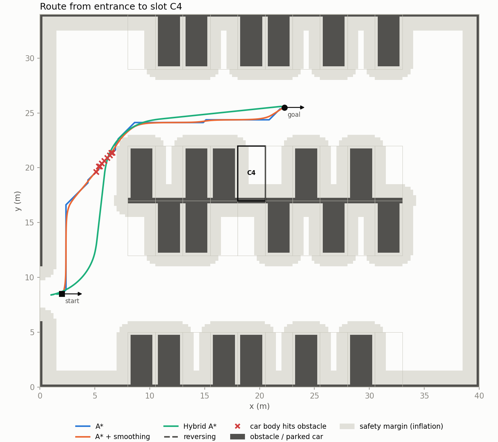
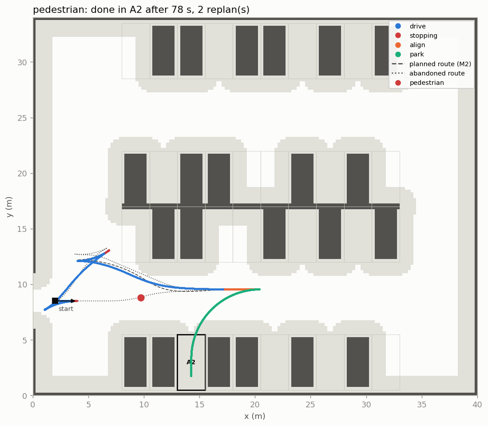

# Autonomous Valet Parking Agent

**CSAI4014 – Algorithms for Intelligent Systems and Robotics (AISR)**
B.Tech CSE (AI & ML), Semester VII | Project P13 | Group G08 | Batch B3

A car-like (Ackermann-steering) vehicle that finds a free slot in a parking lot and parks itself, simulated in **Webots** with a **Python** controller. A deliberative planner plans the route to the slot, and reactive rules handle the close-range parking manoeuvres.

---

## Team

| Member | SAP ID | Module |
|---|---|---|
| Devansh Singh Rawat | 500124378 | M1 - World Sensors |
| Mohammad Shahvez | 500124132 | M4 – Control + Results |
| Harshil Mittal | 500121907 | M3 – Parking Manoeuvres |
| Bhavya Talwar | 500121992 | M2 – Route Planner |

## Modules

| Module | Description |
|---|---|
| **M1 – World and Sensors** | Webots parking lot (slots, parked cars), Ackermann car setup, lidar / distance sensors, GPS, compass, free-slot detection |
| **M2 – Route Planner** | Grid map of the parking lot; route planning from the entrance to the free slot using A* and Hybrid A* |
| **M3 – Parking Manoeuvres** | Reactive close-range rules as a state machine: search → drive → align → park → done |
| **M4 – Control and Results** | Path tracking (pure pursuit / Stanley + PID speed control), experiments, plots and comparison tables |

## AISR Syllabus Topics Covered

- Declarative-Procedural-Reflexive Hierarchy
- Intelligent Agents
- Path Planning
- Moving (vehicle kinematics and control)

## Repository Structure

```
Autonomous-Valet-Parking-Agent/
├── worlds/            # Webots world files (parking lot)
├── controllers/       # Webots Python controllers
│   ├── valet_controller/   # M1 sensor bring-up
│   └── valet_agent/        # whole agent (M1 -> M2 -> M3 -> M4)
├── agent/             # the integrated agent + offline simulator
├── planner/           # A* / Hybrid A* route planner, slot choice, replanning
├── behaviours/        # Parking state machine and reactive rules
├── m4_control/        # Path tracking and speed control
├── results/           # Plots, tables and experiment logs
├── docs/              # Module docs, report sections and viva guide
├── tests/             # Unit tests for every module (run in GitHub Actions)
├── requirements.txt
└── README.md
```

## Requirements

- [Webots](https://cyberbotics.com/) (R2023b or later)
- Python 3.8+
- Python packages: `numpy`, `matplotlib`, `pandas`

Install the Python packages:

```bash
pip install -r requirements.txt
```

## How to Run

1. Clone the repository:
   ```bash
   git clone https://github.com/bhavyatalwar04/Autonomous-Valet-Parking-Agent.git
   ```
2. Open Webots and load `worlds/parking_lot.wbt`.
3. In the scene tree, select the car (`valet_car`) and set its `controller` field to `valet_agent`. The world's default controller, `valet_controller`, only reads the sensors and does not drive.
4. Press **Run**. The car finds the free bays with its lidar, chooses one, plans a route, drives there and reverses in. The console shows the chosen bay, the route and the current phase.

To test the route planner on its own (without Webots), from the repository root:

```bash
python planner/astar.py                  # small standalone A* demo with a plot
python -m unittest discover -s tests     # all unit tests (every module)
python -m planner.compare_planners       # A* vs A* + smoothing vs Hybrid A* -> results/
```

To run the **whole agent** offline (real M1–M4 code, simulated lidar and car), from the repository root:

```bash
python -m agent.run_offline              # normal / slot taken / pedestrian scenarios -> results/agent/
python -m agent.run_offline --sweep      # also park in each of the 40 bays (about 10 min)
```

In Webots, the integrated controller is `controllers/valet_agent`. It runs the same agent as the offline runs. See [docs/integration.md](docs/integration.md) for how the modules connect.

## M3 – Parking Manoeuvres

Implemented by **Harshil Mittal**.

- Parking state machine: search → drive → align → park → done.
- Perpendicular reverse parking with feedback steering and bounded alignment corrections.
- Emergency stops, sensor validation, speed and steering limits, and parking completion checks.

Run the standalone M3 tests from the repository root:

```bash
python -m unittest discover -s tests -p "test_parking.py" -v
```

The 19 tests pass in GitHub Actions. They use synthetic sensor inputs and a kinematic vehicle model. Webots integration and experiments with M1 and M4 remain pending.

See [M3 documentation](docs/m3_parking.md) for interfaces, assumptions and configuration.


How to call the planner from a controller: see [docs/m2_route_planner.md](docs/m2_route_planner.md).

## Results

All numbers below are generated by scripts in this repository. The report's Novelty section ([docs/report/section4_novelty.md](docs/report/section4_novelty.md)) explains them.

### Route planning: A* vs A* + smoothing vs Hybrid A*

Mean over six routes from the entrance ([results/planner_comparison.md](results/planner_comparison.md)):

| Method | Length (m) | Planning time (ms) | Length too tight to drive (m) | Body collisions on the route | Heading error at the goal (°) |
|---|---|---|---|---|---|
| A* | 28.7 | 9.9 | 3.27 | 4.0 | 52.5 |
| A* + smoothing | 28.0 | 21.6 | 3.46 | 1.8 | 44.7 |
| **Hybrid A\*** | 31.0 | 372.9 | **0.00** | **0.0** | **3.4** |

Grid A* is shorter and about 40 times faster, but only Hybrid A* gives routes the car can drive.



### Whole agent: three scenarios

Offline runs with the real M1–M4 code, a simulated lidar and a bicycle model ([results/agent/agent_scenarios.md](results/agent/agent_scenarios.md)):

| Scenario | Result | Time (s) | Replans | Closest gap (m) | Centre error (cm) | Heading error (°) |
|---|---|---|---|---|---|---|
| Normal | Parked in A2 | 52.9 | 0 | 0.20 | 5.0 | 0.08 |
| Another car takes the chosen bay | Parked in B0 | 55.0 | 1 | 0.21 | 5.2 | 0.07 |
| Pedestrian steps onto the route | Parked in A2 | 78.3 | 2 | 0.23 | 5.0 | 0.05 |



### Whole agent: parking in every bay

One run per bay, with both neighbouring bays occupied ([results/agent/agent_sweep.md](results/agent/agent_sweep.md)):

| Row | A | B | C | D | All |
|---|---|---|---|---|---|
| Parked | 9 / 10 | 9 / 10 | 7 / 10 | 9 / 10 | **34 / 40 (85 %)** |

No contact in any of the 40 runs; the closest gap was 0.07 m. The six failures (A8, B8, C0, C8, C9, D1) are at the ends of the aisles, where the safety layer stops the car before it gets too close.

### Webots

The full agent parked in bays A2, B0 and A5 in Webots. Tuning the parking speed and lookahead there cut the parking time by about 19 % (about 45 s to 37 s) and halved the final heading error (about 0.76° to 0.40°). See [docs/m3_webots_tuning.md](docs/m3_webots_tuning.md) and [results/m3_webots_tuning/](results/m3_webots_tuning/), which includes a demo video.

### Path tracking: Pure Pursuit vs Stanley

On an L-shaped route with a reverse park ([results/m4/tables.md](results/m4/tables.md)):

| Controller | RMS tracking error, forward (m) | RMS tracking error, reverse (m) | Parked |
|---|---|---|---|
| Pure Pursuit | 0.096 | 0.023 | Yes |
| Stanley | 0.365 | 0.420 | No |
| Stanley + feed-forward | 0.365 | 0.018 | Yes |

Figures are in [results/m4/figures/](results/m4/figures/).

## Links

- 🎥 Demo video: _to be added_
- 📄 Project report: _to be added_

## Contribution Guidelines (for team members)

- Each member commits **their own code from their own GitHub account**. Commits are used to track individual contributions.
- Work on your own branch (e.g. `m2-planner`) and open a pull request to merge into `main`.
- Write clear commit messages, e.g. `Add A* planner with obstacle grid`.
- Pull the latest `main` before starting work to avoid conflicts.

---

_Course faculty: [Faculty name]_
