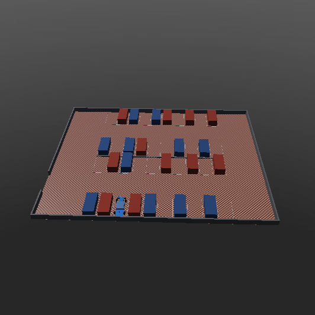

# Parking Manoeuvres (M3)

**Module owner:** Harshil Mittal  
**Project:** Autonomous Valet Parking Agent

This section describes the local parking behaviour, how it hands control to M4, and what the integrated controller did in the latest-main Webots run.

## M3's role

M3 handles the final perpendicular reverse-parking manoeuvre. M1 supplies the car pose, signed speed and body clearances. M2 supplies the selected bay and route to its pre-parking pose. M3 asks M4 to follow that route, then requests low-speed steering and motion for the final parking manoeuvre. M4 is the only module that sends commands to the Webots motors.

The shared pose is measured at the centre of the rear axle. Heading is in radians, counter-clockwise from world +x; speed is positive forward and negative in reverse.

## State machine

The integrated run follows **SEARCH → DRIVE → ALIGN → PARK → DONE**.

| State | Behaviour |
|---|---|
| **SEARCH** | Wait stopped while M1 identifies free bays and M2 selects a reachable bay and plans its route. |
| **DRIVE** | Ask M4 to follow the M2 route, including its forward/reverse direction flags. M3 waits for route completion and a full stop before continuing. |
| **ALIGN** | Move forward to the turning pose beside the target bay, then stop and confirm the setup pose. |
| **PARK** | Reverse along a feedback-controlled quarter-circle and straight segment. If alignment needs correction, stop first and use one of at most two bounded correction attempts. |
| **DONE** | Hold stopped after checking speed, heading, bay-centre position and the full vehicle footprint. |
| **EMERGENCY_STOP / FAILED** | Brake and latch the stop after an unsafe clearance, invalid or stale sensor input, timeout, unsupported geometry or failed manoeuvre. |

M3 returns explicit **FOLLOW_ROUTE**, **PARKING** or **STOP** commands. M4 follows the route for FOLLOW_ROUTE, applies M3's signed speed and steering requests for PARKING, and holds the vehicle for STOP. A direction change is not issued until the car has stopped.

## Manoeuvre and safety

The reverse-in path uses feedback from the measured pose. M3 calculates the desired rear-axle target from the bay centre and vehicle geometry, moves forward to a feasible turning pose, reverses through the turn, and straightens inside the bay. The selected settings are 0.45 m/s parking speed and 0.55 m lookahead; the parameter comparisons and earlier A2, B0 and A5 trials are documented in [M3 Webots tuning](../m3_webots_tuning.md).

The safety layer rejects stale sensor snapshots (older than 0.2 s), missing or non-finite pose, speed or clearances, and clearances below 0.15 m. It also checks the speed-dependent stopping distance using a 0.2 s reaction time and the configured 1 m/s² braking deceleration. Parking speed is limited to 0.5 m/s and bicycle steering to the vehicle's 0.5 rad limit. DONE requires the car to be stopped below 0.03 m/s, within 3° of the bay heading and within 0.15 m of the bay centre, with its corners inside the bay.

## Verification

The existing test file tests/test_parking.py covers state transitions, route handoff, direction changes, stale or invalid sensors, emergency stops, parking completion, slow steering response, obstacle interruption and bounded corrections. The latest-main GitHub Actions checks visible at the time of this run completed successfully for the module tests, M2 planner tests and parking tests.

On 16 November 2026, I ran the integrated agent in Webots R2025b Nightly from the latest-main source snapshot, commit 673f7c205ef2b29ef11d3999909715023dfd58dd. The fresh run began at rear-axle pose (2.00, 8.50, 0°). The car selected A2, completed the route, aligned, reverse-parked and reported DONE: Parking completed at 52.93 simulated seconds. M3's ALIGN-to-DONE interval was 36.67 simulated seconds. The final logged rear-axle pose was (14.25, 1.76) with heading 90° (rounded in the Webots console).

| Latest-main Webots check | Result |
|---|---|
| Target selected by M1/M2 | A2 |
| Route-planning time | 1.22 s |
| ALIGN began | 16.26 s |
| PARK began | 25.54 s |
| DONE | 52.93 s |
| Final state | DONE — Parking completed |

The snapshot's world file still named valet_controller, the sensor-only controller. For this run I used a separate, disposable copy of that exact snapshot and changed only the car's controller field to valet_agent. The GitHub repository was not changed. Devansh's one-word world-file update is still needed for a fresh clone to start the integrated agent when Run is pressed.

## Limits

This was one full integrated run on A2. The additional A2, B0 and A5 measurements in the tuning report are earlier controlled M3 trials on their documented base revision; they are useful tuning evidence, but they are not additional runs on the latest-main snapshot. I did not run a pedestrian case in Webots during this check. The run used simulated sensors and the Webots vehicle model; contact sensing was not instrumented, so a successful DONE state is not an independent measurement of contact-free motion.
